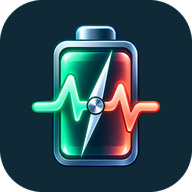
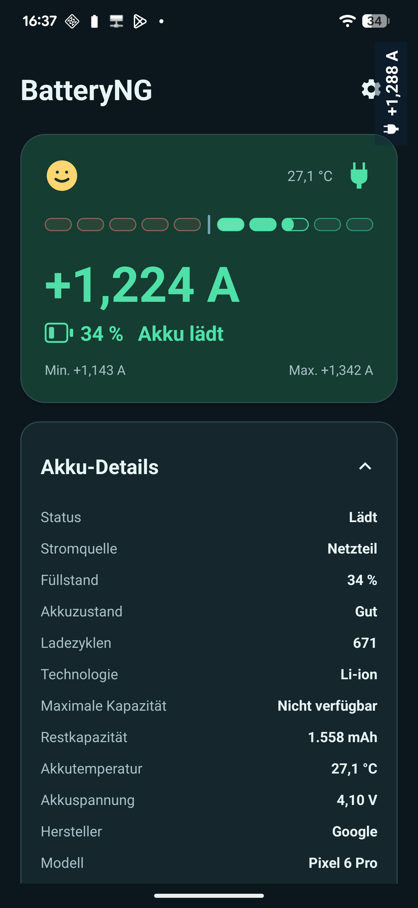

# BatteryNG



Watch the current flowing into or out of your Android battery, live. BatteryNG is open source, works offline, and keeps its optional usage history on your device.

[Download the APK from GitHub Releases](https://github.com/g3orgs/BatteryNG/releases) · [Privacy](PRIVACY.md) · [License](LICENSE)

## English

### What you see

- **Live battery current:** positive values mean the battery is charging; negative values mean it is discharging. The plug icon shows when external power is connected.
- **Clear visual feedback:** a left or right moving bar, battery level, temperature, and session minimum and maximum. Tap **Battery details** to expand or collapse the available Android battery information.
- **Optional floating display:** keep the current visible over the launcher and other apps. While BatteryNG is open you can drag it into place; you can also rotate it, change its text and background, adjust transparency, or show it only while plugged in.
- **Optional app usage list:** see the top 1–10 apps by *estimated* battery use over the last 24 hours or since the last detected full charge (plugged in and above 96%). Tap the heading to collapse the list, or hide it in Settings.
- **Android battery usage:** open Android's own per-app battery report from the app usage section without ADB. Android chooses the report's time range.
- **Your preferences:** choose mA or A, English or German, light or dark theme, and automatic or manual current polarity correction for devices that report the sign backwards.



### Install and use

1. Download the current APK from [Releases](https://github.com/g3orgs/BatteryNG/releases) and install it on Android 6.0 or newer. Android may ask you to allow installation from the app you used to download it.
2. Open BatteryNG. Live current and battery details work immediately, without ADB or special access.
3. Open the **gear icon** for units, language, theme, polarity, the floating display, and optional sections on the home screen. Android's **Display over other apps** permission is required only for the floating display.

The displayed value is **net current at the battery**, not current or voltage at the USB charger. A connected cable can still coincide with a negative value if the battery is discharging. Green indicates positive battery current; it does not confirm fast charging or USB Power Delivery. Measurements depend on what your device reports to Android.

### Optional app usage list

For the no-setup route, tap **Open Android battery usage** in BatteryNG. This opens Android's own report; its period and format are controlled by Android. BatteryNG's embedded 1–10 app ranking is an advanced feature that needs Android usage access and one-time ADB grants. For that ranking, install [Android platform-tools](https://developer.android.com/tools/releases/platform-tools), enable USB debugging on the phone, connect it to your computer, and run:

```bash
adb shell pm grant de.batteryng.mvp android.permission.DUMP
adb shell pm grant de.batteryng.mvp android.permission.PACKAGE_USAGE_STATS
adb shell appops set de.batteryng.mvp GET_USAGE_STATS allow
```

If Android says **“App was denied access”** when you enable Usage Access for the GitHub APK, open **Android Settings → Apps → BatteryNG → ⋮ → Allow restricted settings** and confirm on the device. Then return to **BatteryNG Settings → Open Android Usage Access**, select BatteryNG, and enable access. This is [Android's extra confirmation for apps installed from a browser](https://support.google.com/android/answer/12623953?hl=en); the ADB grants above are still needed for the ranking.

You can open Android's usage access screen from BatteryNG's Settings. The ranking appears after at least two samples; Android may delay background samples. Gaps, resets, and shared app IDs can make the estimates incomplete. Hiding the list does not stop local history collection. Clearing BatteryNG's app data removes its history and settings.

The 0.12.0 GitHub APK was **debug-signed**. Starting with 0.12.1, GitHub builds use a dedicated release key. Android cannot update a debug-signed installation with the new key: uninstall 0.12.0 first, which deletes its local history. If BatteryNG becomes available on F-Droid, its builds will use a different key, so switching installation sources will also require reinstalling.

## Deutsch

### Das zeigt BatteryNG

- **Akkustrom live:** Positive Werte bedeuten, dass der Akku lädt; negative Werte zeigen Entladung. Das Steckersymbol zeigt eine angeschlossene Stromquelle.
- **Anschauliche Anzeige:** Ein Balken läuft bei Entladung nach links und beim Laden nach rechts. Akkustand, Temperatur sowie Minimum und Maximum der aktuellen Sitzung sind sichtbar. **Akku-Details** lassen sich durch Antippen ein- und ausklappen.
- **Optionale schwebende Anzeige:** Der Stromwert bleibt über dem Launcher und anderen Apps sichtbar. Solange BatteryNG geöffnet ist, kannst du die Anzeige verschieben. Drehung, Schrift, Hintergrund, Transparenz und „nur beim Aufladen zeigen“ sind einstellbar.
- **Optionale App-Verbrauchsliste:** Zeige die Top 1–10 Apps nach *geschätztem* Akkuverbrauch der letzten 24 Stunden oder seit der letzten erkannten Vollladung (mit Stromanschluss und über 96 %). Die Liste lässt sich einklappen oder in den Einstellungen ausblenden.
- **Android-Akkuverbrauch:** Öffne Androids eigene App-Verbrauchsübersicht direkt aus BatteryNG, ohne ADB. Den Zeitraum der Übersicht legt Android fest.
- **Deine Einstellungen:** mA oder A, Deutsch oder Englisch, helles oder dunkles Design sowie automatische oder manuelle Korrektur des Stromvorzeichens.

### Installation und Nutzung

1. Lade die aktuelle APK unter [Releases](https://github.com/g3orgs/BatteryNG/releases) herunter und installiere sie auf Android 6.0 oder neuer. Android fragt möglicherweise nach der Erlaubnis für Installationen aus dieser Quelle.
2. Öffne BatteryNG. Die Live-Messung und Akku-Details funktionieren sofort, ohne ADB oder besondere Freigabe.
3. Über das **Zahnrad** erreichst du Einheiten, Sprache, Design, Vorzeichen, schwebende Anzeige und die optionalen Bereiche der Startseite. Nur für die schwebende Anzeige braucht Android die Freigabe **„Über anderen Apps einblenden“**.

Der Wert ist der **Netto-Akkustrom**, nicht der Strom oder die Spannung am USB-Netzteil. Trotz angeschlossenem Kabel kann ein negativer Wert auftreten, wenn sich der Akku entlädt. Grün bedeutet positiven Akkustrom, bestätigt aber weder Schnellladen noch USB Power Delivery. Die Messwerte hängen vom Gerät und seiner Android-Implementierung ab.

### Optionale App-Verbrauchsliste

Für die Nutzung ohne Einrichtung tippe in BatteryNG auf **Android-Akkuverbrauch öffnen**. Damit erscheint Androids eigene Auswertung; Zeitraum und Darstellung bestimmt Android. Die integrierte Rangliste mit 1–10 Apps ist eine erweiterte Funktion. Dafür sind Android-Nutzungszugriff und einmalige ADB-Freigaben nötig. Installiere die [Android Platform Tools](https://developer.android.com/tools/releases/platform-tools), aktiviere USB-Debugging auf dem Telefon, verbinde es mit dem Computer und führe aus:

```bash
adb shell pm grant de.batteryng.mvp android.permission.DUMP
adb shell pm grant de.batteryng.mvp android.permission.PACKAGE_USAGE_STATS
adb shell appops set de.batteryng.mvp GET_USAGE_STATS allow
```

Falls Android beim Aktivieren des Nutzungszugriffs **„App wurde Zugriff verweigert“** meldet, öffne **Android-Einstellungen → Apps → BatteryNG → ⋮ → Eingeschränkte Einstellungen zulassen** und bestätige die Abfrage am Gerät. Gehe danach zurück zu **BatteryNG → Zahnrad → Android-Nutzungszugriff öffnen**, wähle BatteryNG und aktiviere den Zugriff. Das ist [Androids zusätzliche Bestätigung für per Browser installierte Apps](https://support.google.com/android/answer/12623953?hl=de); die ADB-Freigaben oben sind für die Rangliste weiterhin nötig.

Die Android-Seite für den Nutzungszugriff kannst du aus den BatteryNG-Einstellungen öffnen. Die Rangliste erscheint nach mindestens zwei Messpunkten; Android kann Hintergrundmessungen verzögern. Messlücken, Zähler-Resets und gemeinsam genutzte App-IDs können die Schätzung verfälschen. Das Ausblenden der Liste beendet die lokale Verlaufserfassung nicht. Beim Löschen der App-Daten gehen Verlauf und Einstellungen verloren.

Die GitHub-APK 0.12.0 war **debug-signiert**. Ab 0.12.1 verwenden GitHub-Builds einen eigenen Release-Schlüssel. Android kann die Debug-Installation mit dem neuen Schlüssel nicht aktualisieren: Deinstalliere 0.12.0 zuerst; dabei geht ihr lokaler Verlauf verloren. Falls BatteryNG bei F-Droid erscheint, werden dessen Builds einen anderen Schlüssel nutzen. Der Wechsel der Bezugsquelle erfordert dann ebenfalls eine Neuinstallation.

BatteryNG benötigt keine Netzwerkberechtigung. Quellcode und App-Icon stehen unter [Apache-2.0](LICENSE); weitere Informationen findest du unter [Datenschutz](PRIVACY.md).
