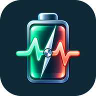
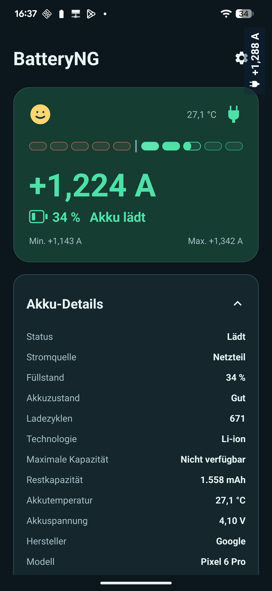

## English

BatteryNG 0.12.1 keeps the features of 0.12.0 and changes the GitHub APK to a non-debuggable build signed with a dedicated release key.

Download **BatteryNG.apk** for Android 6.0 or newer. Live battery current works without additional permissions. The optional app-usage ranking needs one-time ADB grants; see the [README](https://github.com/g3orgs/BatteryNG#readme).

**Updating:** The 0.12.0 GitHub APK was signed with a debug key. Android cannot update it in place with this new signing key. Uninstall 0.12.0 before installing 0.12.1; uninstalling deletes BatteryNG's local settings and usage history. A future F-Droid build would also use a different key.

SHA-256 of `BatteryNG.apk`: `bcf939fcc3b51f30295ba0dbeea00ef7c95b8f98d3831a71a97b231ad2a9034e`

## Deutsch

BatteryNG 0.12.1 enthält dieselben Funktionen wie 0.12.0. Die GitHub-APK ist jetzt ein nicht debuggable Release-Build mit eigenem Signierschlüssel.

Lade **BatteryNG.apk** für Android 6.0 oder neuer herunter. Die Live-Messung funktioniert ohne zusätzliche Freigaben. Für die optionale App-Verbrauchsliste sind einmalige ADB-Freigaben nötig; die Anleitung steht in der [README](https://github.com/g3orgs/BatteryNG#deutsch).

**Update-Hinweis:** Die GitHub-APK 0.12.0 wurde mit einem Debug-Schlüssel signiert. Wegen des neuen Schlüssels kann Android sie nicht direkt aktualisieren. Deinstalliere 0.12.0 vor der Installation von 0.12.1; dabei gehen lokale Einstellungen und Verbrauchsdaten verloren. Ein künftiger F-Droid-Build würde ebenfalls einen anderen Schlüssel verwenden.

SHA-256 von `BatteryNG.apk`: `bcf939fcc3b51f30295ba0dbeea00ef7c95b8f98d3831a71a97b231ad2a9034e`
