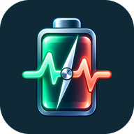

## English

BatteryNG 0.12.2 adds **Open Android battery usage** to the app section on the home screen. It opens Android's own per-app battery report without ADB or BatteryNG usage access. Android controls that report's time range and presentation; the values are not imported into BatteryNG.

BatteryNG's embedded top-app ranking over the last 24 hours or since the last full charge remains an advanced feature requiring one-time ADB grants. Live battery current and the floating display are unchanged.

The APK uses the same release signing key as 0.12.1 and updates it in place. An installed 0.12.0 debug build still requires uninstalling first, which removes its local settings and usage history.

SHA-256 of `BatteryNG.apk`: `197b93d04dfcd4c45d40e777c58fce9de5be7f5e1e61034ed9838699d9c05480`

## Deutsch

BatteryNG 0.12.2 ergänzt im App-Bereich des Startbildschirms den Button **Android-Akkuverbrauch öffnen**. Er zeigt Androids eigene App-Verbrauchsübersicht ohne ADB und ohne BatteryNG-Nutzungszugriff. Android bestimmt Zeitraum und Darstellung dieser Übersicht; ihre Werte werden nicht in BatteryNG übernommen.

Die integrierte Rangliste für die letzten 24 Stunden oder seit der letzten Vollladung bleibt eine erweiterte Funktion mit einmaligen ADB-Freigaben. Die Live-Strommessung und die schwebende Anzeige bleiben unverändert.

Die APK verwendet denselben Release-Signierschlüssel wie 0.12.1 und kann diese Version direkt aktualisieren. Eine installierte Debug-Version 0.12.0 muss weiterhin zuerst deinstalliert werden; dabei gehen lokale Einstellungen und Verbrauchsdaten verloren.

SHA-256 von `BatteryNG.apk`: `197b93d04dfcd4c45d40e777c58fce9de5be7f5e1e61034ed9838699d9c05480`
